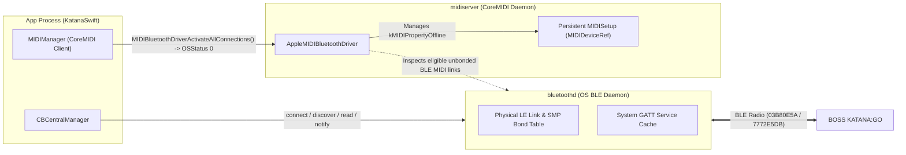

# Learning Report: Programmatic BLE MIDI Connection & CoreMIDI Promotion (`MIDIBluetoothDriverActivateAllConnections`)

**Date:** November 16, 2026  
**Target Hardware:** BOSS KATANA:GO (`KATANA:GO MIDI`)  
**Host Environment:** iPhone 17 Pro Max (iOS 26), Xcode / Swift 6, `KatanaSwift` (`ble_scan_connect_idea`)  
**Frameworks Evaluated:** `CoreBluetooth`, `CoreMIDI` (`MIDIBluetoothConnection.h`), `CoreAudioKit` (`CABTMIDICentralViewController`), `SwiftMIDIIO` (`1.1.0`)

---

## 1. Executive Summary

### Objective
Eliminate the need for end users to manually open and tap through Apple's built-in system UI (`CABTMIDICentralViewController` on iOS or `CABTLEMIDIWindowController` / Audio MIDI Setup on macOS) before `KatanaSwift` can discover and communicate with a BOSS Katana over Bluetooth Low Energy (BLE). Specifically, evaluate Apple's `MIDIBluetoothDriverActivateAllConnections()` API (introduced in iOS 16 / macOS 13) to programmatically promote a `CoreBluetooth` peripheral connection into an online `CoreMIDI` endpoint.

### Key Findings (TL;DR)
1. **Direct CoreBluetooth GATT + OS Pairing Works Reliably (< 1s):**  
   Scanning via `CBCentralManager` for the standard BLE MIDI service (`03B80E5A-EDE8-4B33-A751-6CE34EC4C700`), connecting to `KATANA:GO MIDI`, discovering the MIDI I/O characteristic (`7772E5DB-3868-4112-A1A9-F2669D106BF3`), triggering the native iOS *"Bluetooth Pairing Request"* dialog via a GATT read, and enabling CCCD notifications (`isNotifying = true`) **succeeds end-to-end in ~900 ms** (once bonded).
2. **`MIDIBluetoothDriverActivateAllConnections()` Silently No-Ops for `KATANA:GO`:**  
   Across **four** systematic hardware iterations testing every valid combination of GATT handshake depth and `MIDISetup` state, `MIDIBluetoothDriverActivateAllConnections()` always returns `noErr` (`OSStatus 0`), yet `com.apple.AppleMIDIBluetoothDriver` (`midiserver`) emits **zero** CoreMIDI notifications and never brings a Katana `MIDIDeviceRef` or `MIDIEndpointRef` online.
3. **Root Cause — Pairing vs. Non-Pairing BLE MIDI Peripherals:**  
   Apple's CoreMIDI *MIDI Bluetooth* documentation specifies that `MIDIBluetoothDriverActivateAllConnections()` is intended **for BLE MIDI peripherals that do *not* support pairing**. Devices that require BLE Security Manager Protocol (SMP) pairing/bonding—including BOSS/Roland BLE MIDI hardware (`KATANA:GO`, `BT-DUAL`, `WM-1`)—are only registered into `AppleMIDIBluetoothDriver`'s auto-reconnect table when initially paired through Apple's system UI (`CABTMIDICentralViewController`). When an app pairs via `CBCentralManager` directly, `bluetoothd` establishes the OS-level LE bond, but `AppleMIDIBluetoothDriver` ignores the connection.
4. **Path Forward for `KatanaSwift`:**  
   To achieve zero-UI programmatic BLE connection on Katana hardware, `KatanaSwift` should bypass CoreMIDI promotion for BLE-discovered devices and exchange Roland SysEx messages directly over CoreBluetooth's notifying MIDI I/O characteristic (`7772E5DB-3868-4112-A1A9-F2669D106BF3`), while keeping CoreMIDI discovery active for USB-C and pre-existing online MIDI endpoints.

---

## 2. Technical Background

### 2.1 Standard BLE MIDI GATT Profile
The BOSS `KATANA:GO` implements the standard MIDI Manufacturers Association (MMA) / Apple Bluetooth LE MIDI specification:

| Item | Value / UUID | Notes |
| :--- | :--- | :--- |
| **Advertised Local Name** | `KATANA:GO MIDI` | Separate from the A2DP audio profile (`KATANA:GO AUDIO`) |
| **BLE MIDI Service UUID** | `03B80E5A-EDE8-4B33-A751-6CE34EC4C700` | Advertised in scan response / AD packets |
| **MIDI Data I/O Characteristic** | `7772E5DB-3868-4112-A1A9-F2669D106BF3` | Single characteristic used for both MIDI In and MIDI Out |
| **Observed `CBCharacteristicProperties`** | `22` (`0x16`) | `.read (0x02)` \| `.writeWithoutResponse (0x04)` \| `.notify (0x10)` |
| **GATT Security Requirement** | Authenticated / Encrypted Link | Reading or subscribing triggers BLE SMP pairing if unbonded |

### 2.2 Two Separate Bluetooth/MIDI Processes on iOS & macOS
Understanding why CoreBluetooth and CoreMIDI can diverge requires recognizing that two separate system daemons are involved:



1. **`bluetoothd` (CoreBluetooth daemon):** Owns the physical BLE radio connection, GATT attribute cache, and SMP encryption keys (visible in **iOS Settings → Bluetooth**).
2. **`midiserver` + `com.apple.AppleMIDIBluetoothDriver`:** Runs in a separate OS daemon process with its own internal `CBCentralManager` and its own persistent `MIDISetup` database of `MIDIDeviceRef` objects.
   - Importantly, tapping **Forget This Device** in **iOS Settings → Bluetooth** deletes the SMP bond from `bluetoothd`, **but does NOT delete the offline `MIDIDeviceRef` from `midiserver`'s `MIDISetup`**.

### 2.3 Apple's Documented Contract vs. Fine Print
In `<CoreMIDI/MIDIBluetoothConnection.h>`, Apple documents the 6-step promotion workflow:
1. Using CoreBluetooth API, scan for the peripheral's advertised LE MIDI service.
2. Using CoreBluetooth API, connect to the desired advertised peripheral.
3. Upon successful connection, call `MIDIBluetoothDriverActivateAllConnections()`.
4. Using CoreMIDI API, confirm the peripheral's registration by locating its `MIDIDeviceRef`.
5. If present, CoreMIDI now owns a connection to the peripheral.
6. Using CoreBluetooth API, disconnect from the peripheral now managed by CoreMIDI.

However, Apple's companion CoreMIDI developer documentation (*MIDI Bluetooth*) adds a critical distinction regarding **pairing**:
- **Devices that support pairing:** In iOS 16+ / macOS 13+, the OS automatically reconnects known BLE MIDI peripherals when powered on *after* they have been paired through the system's Bluetooth MIDI UI (`CABTMIDICentralViewController` / Audio MIDI Setup).
- **Devices that do *not* support pairing:** Developers can connect manually via CoreBluetooth, verify the BLE MIDI service and MIDI I/O characteristic, and call `MIDIBluetoothDriverActivateAllConnections()` to promote those connections into online MIDI devices.

Roland's own support documentation for `KATANA:GO`, `BT-DUAL`, and `WM-1` corroborates this from the hardware side: Roland instructs users **never** to pair `KATANA:GO MIDI` directly through iOS's general Bluetooth settings, noting that if an OS-level Bluetooth bond is created outside CoreMIDI's in-app BLE MIDI setup, CoreMIDI will fail to bring the MIDI port online until the user selects *Forget This Device*.

---

## 3. Chronological Experiments, Code Samples & Hardware Logs

All four iterations below were executed on a physical **iPhone 17 Pro Max (iOS 26)** against a **BOSS KATANA:GO** (`EC0A9037-B819-780D-6385-9D4B1901E1C4`).

---

### Iteration 1: Link-Layer `CBCentralManager.connect` Only

#### Hypothesis
Following the literal header comment in `MIDIBluetoothConnection.h` ("connect to the desired advertised peripheral → upon successful connection, call `MIDIBluetoothDriverActivateAllConnections`"), we initially hypothesized that completing `centralManager(_:didConnect:)` was sufficient for `AppleMIDIBluetoothDriver` to detect and promote the connection.

#### What We Tried
`BluetoothCentral.connect(_:timeout:)` resumed its continuation immediately inside `centralManager(_:didConnect:)`, and `KatanaScannerImpl.promote(_:)` called `MIDIBluetoothDriverActivateAllConnections()` and polled `midiManager.outputEndpoints`:

```swift
// Iteration 1: Resume immediately on link-layer didConnect (no GATT discovery)
public func centralManager(_ central: CBCentralManager, didConnect peripheral: CBPeripheral) {
  finishConnectWaiter(for: peripheral.identifier)
}

// Scanner promotion flow:
try await central.connect(peripheral.id, timeout: configuration.connectionTimeout)
try bluetoothDriver.activateAllConnections()
let endpoint = try await waitForNewKatanaEndpoint(excluding: beforeIDs)
central.cancelConnection(peripheral.id)
```

#### What Happened
- `central.connect(...)` and `activateAllConnections()` both succeeded without throwing.
- `waitForNewKatanaEndpoint` timed out after 5 seconds and logged `Failed to promote peripheral...`.

#### Post-Iteration Analysis & New Hypotheses
1. **Unpopulated `bluetoothd` GATT Cache:** Advertising a service UUID is distinct from exposing it in GATT. In CoreBluetooth on iOS, another process calling `CBCentralManager.retrieveConnectedPeripherals(withServices: [BLE_MIDI_UUID])` (which `midiserver` relies on) will **not** see a connected peripheral unless `discoverServices` has populated `bluetoothd`'s GATT cache for that peripheral.
2. **Unbonded Link:** On an unpaired `KATANA:GO`, link-layer `connect` alone does not trigger BLE SMP pairing/encryption—only reading or subscribing to a protected characteristic triggers iOS's pairing dialog.
3. **Offline CoreMIDI Endpoint Caching:** `SwiftMIDIIO`'s endpoints have an `isOffline` property (`kMIDIPropertyOffline`). If a Katana was paired in an earlier session, `beforeIDs` must filter by `isOnline` (`!(isOffline.value ?? false)`) so an existing offline endpoint transitioning to `isOnline == true` isn't mistakenly excluded as "already present before scan."

---

### Iteration 2: GATT Service/Characteristic Discovery + `readValue(for:)` Pairing Handshake

#### Hypothesis
If `BluetoothCentral` discovers the BLE MIDI Service (`03B80E5A-...`), discovers the MIDI I/O Characteristic (`7772E5DB-...`), and performs an initial `peripheral.readValue(for: midiCharacteristic)` before returning from `connect(_:timeout:)`, then:
1. `bluetoothd` will cache the validated BLE MIDI GATT service/characteristic, and
2. iOS will present the system Bluetooth pairing prompt and establish an encrypted bond before `MIDIBluetoothDriverActivateAllConnections()` is invoked.

We also paused `CBCentralManager` scanning during promotion (`stopScan()`) to avoid radio contention, increased `connectionTimeout` to `15s` so the user had time to accept the OS pairing dialog, and added a midpoint re-invocation of `activateAllConnections()` at `2.5s`.

#### What We Tried
```swift
// Iteration 2: Connect -> Discover Service -> Discover Characteristic -> Read Value
public func centralManager(_ central: CBCentralManager, didConnect peripheral: CBPeripheral) {
  peripheral.delegate = self
  peripheral.discoverServices([KatanaBLESignature.midiServiceUUID])
}

public func peripheral(_ peripheral: CBPeripheral, didDiscoverServices error: Error?) {
  guard error == nil,
    let midiService = peripheral.services?.first(where: {
      $0.uuid == KatanaBLESignature.midiServiceUUID
    })
  else {
    finishConnectWaiter(for: peripheral.identifier, error: KatanaError.bluetoothPromotionFailed("..."))
    return
  }
  peripheral.discoverCharacteristics([KatanaBLESignature.midiIOCharacteristicUUID], for: midiService)
}

public func peripheral(
  _ peripheral: CBPeripheral,
  didDiscoverCharacteristicsFor service: CBService,
  error: Error?
) {
  guard error == nil,
    let midiChar = service.characteristics?.first(where: {
      $0.uuid == KatanaBLESignature.midiIOCharacteristicUUID
    })
  else {
    finishConnectWaiter(for: peripheral.identifier, error: KatanaError.bluetoothPromotionFailed("..."))
    return
  }
  if midiChar.properties.contains(.read) {
    peripheral.readValue(for: midiChar) // Triggers iOS SMP pairing dialog on unbonded devices
  } else {
    finishConnectWaiter(for: peripheral.identifier)
  }
}

public func peripheral(
  _ peripheral: CBPeripheral,
  didUpdateValueFor characteristic: CBCharacteristic,
  error: Error?
) {
  if let nsError = error as? NSError, nsError.domain == CBATTErrorDomain,
     [.insufficientAuthentication, .insufficientEncryption, .insufficientAuthorization]
       .contains(CBATTError.Code(rawValue: nsError.code)) {
    finishConnectWaiter(for: peripheral.identifier, error: KatanaError.connectionFailed("Pairing failed"))
    return
  }
  finishConnectWaiter(for: peripheral.identifier)
}
```

#### Hardware Result & Captured Log
Tested with an **unpaired** `KATANA:GO`. During `readValue(for:)`, **iOS displayed the native system Bluetooth pairing prompt**, and the user tapped **Pair**. The GATT read succeeded—yet CoreMIDI still exposed zero output endpoints:

```text
Promoting BLE Katana peripheral EC0A9037-B819-780D-6385-9D4B1901E1C4 (KATANA:GO MIDI)
Connecting to peripheral EC0A9037-B819-780D-6385-9D4B1901E1C4
Connected to peripheral EC0A9037-B819-780D-6385-9D4B1901E1C4; discovering BLE MIDI service
Discovered BLE MIDI service on EC0A9037-B819-780D-6385-9D4B1901E1C4; discovering MIDI I/O characteristic
Reading MIDI I/O characteristic on EC0A9037-B819-780D-6385-9D4B1901E1C4 to complete pairing/encryption handshake
BLE MIDI GATT handshake completed for EC0A9037-B819-780D-6385-9D4B1901E1C4
Connected & verified BLE MIDI GATT for EC0A9037-B819-780D-6385-9D4B1901E1C4; activating CoreMIDI
Re-invoking MIDIBluetoothDriverActivateAllConnections at promotion midpoint
Timed out waiting for online Katana MIDI endpoint. Outputs: []
Failed to promote peripheral EC0A9037-B819-780D-6385-9D4B1901E1C4: Bluetooth promotion failed: Timed out waiting for MIDI endpoint to appear after activation.
```

---

### Iteration 3: CCCD Notification Subscription (`setNotifyValue(true)`), Single Activation, 10s Window & Deep CoreMIDI Instrumentation

#### Hypotheses Tested
After Iteration 2 proved that CoreBluetooth connection, GATT discovery, and OS pairing all succeeded while `Outputs` remained `[]`, we formulated four ranked hypotheses and built full diagnostics to test them simultaneously:
1. **Asynchronous driver timing & midpoint disruption:** `MIDIBluetoothDriverActivateAllConnections()` has no completion handler; 5s may be too short after a fresh bond, and calling `try? activateAllConnections()` a second time at 2.5s may reset `AppleMIDIBluetoothDriver`'s in-flight state machine (while `try?` hid any non-zero `OSStatus`).
2. **Post-bond peripheral disconnect / re-keying:** `KATANA:GO` might drop or reset the BLE connection right after bonding, which we weren't logging once `connect` returned.
3. **Unobserved CoreMIDI driver error:** CoreMIDI reports driver-level failures via `MIDIIONotification.ioError(device:error:)`, which we weren't subscribed to.
4. **Missing CCCD notification subscription (`setNotifyValue(true)`):** `AppleMIDIBluetoothDriver` might require the MIDI I/O characteristic to have Client Characteristic Configuration Descriptor (CCCD) notifications enabled (`isNotifying == true`).

#### What We Tried
- Extracted a pure, unit-tested `BLEMIDIHandshake` state machine adding `.enableNotifications` (`peripheral.setNotifyValue(true, for: midiCharacteristic)`) and waiting for `peripheral(_:didUpdateNotificationStateFor:error:)` with `isNotifying == true`.
- Logged millisecond-level step timings, characteristic `properties` bitmask, and raw `OSStatus` from `MIDIBluetoothDriverActivateAllConnections()`.
- Removed the midpoint re-activation call and extended `promotionTimeout` from `5s` to `10s`.
- Installed `MIDIManager.notificationHandler` to capture `.setupChanged`, `.added`, `.removed`, `.propertyChanged`, and `.ioError`, and logged a 1-second diagnostic snapshot of **all** CoreMIDI `MIDIDevice` entries (`name`, `uniqueID`, `isOffline`, `driverOwner`), endpoints, and `CBPeripheral.state`:

```swift
// Iteration 3: Enable notifications before completing GATT handshake
case .enableNotifications:
  logger.notice("[\(ms)ms] Enabling notifications on MIDI I/O characteristic on \(id)")
  peripheral.setNotifyValue(true, for: char)

// Wait for confirmation in peripheral(_:didUpdateNotificationStateFor:error:)
let step = waiter.handshake.handle(
  .notificationStateUpdated(
    isNotifying: characteristic.isNotifying,
    security: securityError,
    otherError: error?.localizedDescription
  )
)
if step == .done {
  finishConnectWaiter(for: id)
}
```

```swift
// Iteration 3: Log raw OSStatus & poll full CoreMIDI device table
public func activateAllConnections() throws {
  let status = MIDIBluetoothDriverActivateAllConnections()
  logger.notice("MIDIBluetoothDriverActivateAllConnections -> OSStatus \(status)")
  guard status == noErr else {
    throw KatanaError.bluetoothPromotionFailed("MIDIBluetoothDriverActivateAllConnections OSStatus \(status)")
  }
}
```

#### Hardware Result & Captured Log
```text
Promoting BLE Katana peripheral EC0A9037-B819-780D-6385-9D4B1901E1C4 (KATANA:GO MIDI)
[0ms] Connecting to peripheral EC0A9037-B819-780D-6385-9D4B1901E1C4 (state: disconnected)
[491ms] Connected to peripheral EC0A9037-B819-780D-6385-9D4B1901E1C4 (state: connected); discovering BLE MIDI service
[662ms] Discovered BLE MIDI service on EC0A9037-B819-780D-6385-9D4B1901E1C4 (state: connected); discovering MIDI I/O characteristic
[722ms] Discovered characteristics for EC0A9037-B819-780D-6385-9D4B1901E1C4: found=true, properties=22, canRead=true, canNotify=true (state: connected)
[722ms] Reading MIDI I/O characteristic on EC0A9037-B819-780D-6385-9D4B1901E1C4 to trigger pairing/encryption handshake
[783ms] Read MIDI I/O characteristic completed successfully on EC0A9037-B819-780D-6385-9D4B1901E1C4 (state: connected)
[783ms] Enabling notifications on MIDI I/O characteristic on EC0A9037-B819-780D-6385-9D4B1901E1C4
[902ms] Notification state updated on EC0A9037-B819-780D-6385-9D4B1901E1C4: isNotifying=true (state: connected)
[902ms] BLE MIDI GATT handshake completed successfully for EC0A9037-B819-780D-6385-9D4B1901E1C4
Connected & verified BLE MIDI GATT for EC0A9037-B819-780D-6385-9D4B1901E1C4; activating CoreMIDI
MIDIBluetoothDriverActivateAllConnections -> OSStatus 0
Promotion in-flight [1s]: Peripheral EC0A9037-B819-780D-6385-9D4B1901E1C4 state=connected | Devices: ['Bluetooth' (uniqueID: -1484772947, offline: false, driverOwner: 'com.apple.AppleMIDIBluetoothDriver'), 'KATANA:GO MIDI' (uniqueID: 575236311, offline: true, driverOwner: 'com.apple.AppleMIDIBluetoothDriver'), 'Henry’s MacBook Pro' (uniqueID: -1194527627, offline: true, driverOwner: 'com.apple.AppleMIDIBluetoothDriver'), 'Network' (uniqueID: -1630340087, offline: false, driverOwner: 'com.apple.AppleMIDINetworkDriver'), 'UMP Network' (uniqueID: 80043084, offline: false, driverOwner: 'com.apple.AppleMIDINetworkDriver')]; Outputs: []; Inputs: [] | Notifications: [none]
...
Promotion in-flight [9s]: Peripheral EC0A9037-B819-780D-6385-9D4B1901E1C4 state=connected | Devices: [ ... same ... ]; Outputs: []; Inputs: [] | Notifications: [none]
Timed out waiting for MIDI endpoint to appear after activation. ...
Peripheral EC0A9037-B819-780D-6385-9D4B1901E1C4 disconnected: domain=none, code=0, error=clean disconnect
```

#### What Iteration 3 Proved
- **All four Round 2 hypotheses were eliminated:** `OSStatus` was `0`, `isNotifying=true` succeeded at `902ms`, `state=connected` never dropped during the entire 10s window, and CoreMIDI emitted zero `ioError` or setup notifications (`Notifications: [none]`).
- **Major revelation in `Devices:`:** CoreMIDI *already* had `'KATANA:GO MIDI' (uniqueID: 575236311, offline: true, driverOwner: 'com.apple.AppleMIDIBluetoothDriver')` persisted in `MIDISetup` from an earlier `CABTMIDICentralViewController` session! Moreover, because `readValue` finished in `61ms` (`722ms → 783ms`) with no OS dialog, this run already possessed the `bluetoothd` bond from Iteration 2—yet neither iOS's built-in paired auto-reconnect nor `MIDIBluetoothDriverActivateAllConnections()` flipped `575236311` from `offline: true` to `offline: false`.

---

### Iteration 4: Purging Stale `MIDISetup` Record + Discovery-Only GATT Handshake (No `readValue` / No `setNotifyValue`)

#### Remaining Hypotheses to Eliminate
Before concluding that `AppleMIDIBluetoothDriver` categorically ignores `KATANA:GO` in `ActivateAllConnections()`, two untested possibilities remained:
1. **Stale `MIDIDeviceRef` conflict:** The orphaned offline `MIDIDevice` (`uniqueID: 575236311`) in `midiserver`'s `MIDISetup` might hold stale pairing metadata from before *Forget This Device* was tapped, causing `ActivateAllConnections()` to skip creating a duplicate device while failing to revive `575236311`.
2. **App GATT read/notify preempting `midiserver`:** Iteration 1 had skipped `discoverServices` (leaving `bluetoothd`'s GATT cache empty), while Iterations 2 and 3 had added `discoverServices` + `discoverCharacteristics` *and* `readValue` (causing our app to initiate SMP pairing). We had never tested stopping immediately after `discoverServices` + `discoverCharacteristics` (zero reads, zero CCCD writes) on a freshly forgotten Katana so `midiserver` itself could initiate the first encrypted GATT operation.

#### What We Tried
1. Inspected all private driver properties on offline Katana `MIDIDeviceRef`s via `MIDIObjectGetProperties(_:_:true)` and removed them from `midiserver`'s `MIDISetup` via `MIDISetupRemoveDevice(_:)`:
   ```swift
   var propsPtr: Unmanaged<CFPropertyList>?
   let propStatus = MIDIObjectGetProperties(dev.coreMIDIObjectRef, &propsPtr, true)
   let properties = propsPtr?.takeRetainedValue()
   let removeStatus = MIDISetupRemoveDevice(dev.coreMIDIObjectRef)
   ```
2. Configured `BLEMIDIHandshake(performSecurityHandshake: false)` to finish `.done` right after confirming `7772E5DB-3868-4112-A1A9-F2669D106BF3` exists—without calling `readValue(for:)` or `setNotifyValue(true, for:)`.
3. Forgot `KATANA:GO MIDI` in **iOS Settings → Bluetooth**, placed `KATANA:GO` into `PAIRING` mode, and ran once.

#### Hardware Result & Captured Log
```text
Promoting BLE Katana peripheral EC0A9037-B819-780D-6385-9D4B1901E1C4 (KATANA:GO MIDI)
Purged offline device 'KATANA:GO MIDI' (uniqueID: 575236311): removeStatus=0, properties={
    "BLE MIDI Device UUID" = "EC0A9037-B819-780D-6385-9D4B1901E1C4";
    "MIDI Input Supported" = 1;
    "MIDI Local Peripheral" = 0;
    "MIDI Output Supported" = 1;
    "MIDI Remote Peripheral" = 1;
    driver = "com.apple.AppleMIDIBluetoothDriver";
    entities =     (
                {
            destinations = ( { uniqueID = 1676673484; } );
            embedded = 1;
            maxSysExSpeed = 3125;
            name = Bluetooth;
            protocol = 1;
            sources = ( { uniqueID = 352368259; } );
            uniqueID = 466939984;
        }
    );
    manufacturer = "Manufacturer Unavailable";
    model = "Model Unavailable";
    name = "KATANA:GO MIDI";
    offline = 1;
    uniqueID = 575236311;
}
[0ms] Connecting to peripheral EC0A9037-B819-780D-6385-9D4B1901E1C4 (state: disconnected)
CoreMIDI notification: removed outputEndpoint '' (parent: )
CoreMIDI notification: removed inputEndpoint '' (parent: )
CoreMIDI notification: removed entity '' (parent: KATANA:GO MIDI)
CoreMIDI notification: removed device 'KATANA:GO MIDI' (parent: none)
CoreMIDI notification: setupChanged
[616ms] Connected to peripheral EC0A9037-B819-780D-6385-9D4B1901E1C4 (state: connected); discovering BLE MIDI service
[791ms] Discovered BLE MIDI service on EC0A9037-B819-780D-6385-9D4B1901E1C4 (state: connected); discovering MIDI I/O characteristic
[851ms] Discovered characteristics for EC0A9037-B819-780D-6385-9D4B1901E1C4: found=true, properties=22, canRead=true, canNotify=true (state: connected)
[851ms] BLE MIDI characteristic verified (discovery-only handshake completed for EC0A9037-B819-780D-6385-9D4B1901E1C4)
Connected & verified BLE MIDI GATT for EC0A9037-B819-780D-6385-9D4B1901E1C4; activating CoreMIDI
MIDIBluetoothDriverActivateAllConnections -> OSStatus 0
Promotion in-flight [1s]: Peripheral EC0A9037-B819-780D-6385-9D4B1901E1C4 state=connected | Devices: ['Bluetooth' (uniqueID: -1484772947, offline: false, driverOwner: 'com.apple.AppleMIDIBluetoothDriver'), 'Henry’s MacBook Pro' (uniqueID: -1194527627, offline: true, driverOwner: 'com.apple.AppleMIDIBluetoothDriver'), 'Network' (uniqueID: -1630340087, offline: false, driverOwner: 'com.apple.AppleMIDINetworkDriver'), 'UMP Network' (uniqueID: 80043084, offline: false, driverOwner: 'com.apple.AppleMIDINetworkDriver')]; Outputs: []; Inputs: [] | Notifications: [none]
...
Promotion in-flight [9s]: Peripheral EC0A9037-B819-780D-6385-9D4B1901E1C4 state=connected | Devices: [ ... same ... ]; Outputs: []; Inputs: [] | Notifications: [none]
Timed out waiting for MIDI endpoint to appear after activation. ...
Peripheral EC0A9037-B819-780D-6385-9D4B1901E1C4 disconnected: domain=none, code=0, error=clean disconnect
```

#### What Iteration 4 Conclusively Proved
1. **Our CoreMIDI notification observer is 100% live:** Removing `575236311` immediately delivered five CoreMIDI notifications (`removed outputEndpoint`, `removed inputEndpoint`, `removed entity`, `removed device`, `setupChanged`), proving that `Notifications: [none]` after `ActivateAllConnections()` is genuine driver silence.
2. **Stale `MIDISetup` state was NOT the blocker:** Even with `575236311` completely purged from `MIDISetup` (and its stored `"BLE MIDI Device UUID"` confirmed identical to `EC0A9037-B819-780D-6385-9D4B1901E1C4`), `ActivateAllConnections()` did nothing. *(Note: `MIDISetupRemoveDevice` should **not** be kept in production code, because deleting offline Bluetooth `MIDIDeviceRef`s erases valid `CABTMIDICentralViewController` auto-reconnect entries.)*
3. **App GATT reads/subscribes were NOT blocking `midiserver`:** Completing `connect` → `discoverServices` → `discoverCharacteristics` with zero reads or CCCD writes matches Apple's documented steps verbatim, yet `midiserver` never initiated pairing or created a `MIDIDeviceRef`.

---

## 4. Complete Hypothesis Matrix

| # | Hypothesis | How It Was Tested | Empirical Evidence | Verdict |
| :- | :--- | :--- | :--- | :--- |
| **H1** | Link-layer `CBCentralManager.connect` alone is enough before calling `ActivateAllConnections()` | Iteration 1 (`didConnect` → `activateAllConnections()`) | Timed out; `bluetoothd` GATT service cache not even populated yet | **Disproved** |
| **H2** | Completing GATT discovery + `readValue` (triggering OS SMP pairing) enables `ActivateAllConnections()` | Iteration 2 (unpaired Katana; accepted iOS pairing dialog) | Pairing succeeded, GATT read succeeded, `Outputs: []` | **Disproved** |
| **H3** | `ActivateAllConnections()` is returning a non-zero `OSStatus` error | Iterations 3 & 4 (`OSStatus` logged at `.notice`) | Returned `OSStatus 0` (`noErr`) on every call | **Disproved** |
| **H4** | Promotion is slower than 5s or disrupted by midpoint re-invocation | Iterations 3 & 4 (single call, 10s window, 1s snapshots) | Zero CoreMIDI notifications over full 10s (`Notifications: [none]`) | **Disproved** |
| **H5** | `KATANA:GO` drops or re-keys the BLE connection right after bonding | Iterations 3 & 4 (`peripheralState` + `didDisconnectPeripheral` logging) | `state=connected` held steady from ~500ms until our own `cancelConnection` at 10s | **Disproved** |
| **H6** | CoreMIDI is reporting an internal driver failure via `MIDIIONotification.ioError` | Iterations 3 & 4 (`MIDIManager.notificationHandler` verified live) | Observer received purge events, then `Notifications: [none]` during promotion | **Disproved** |
| **H7** | `AppleMIDIBluetoothDriver` requires CCCD notifications (`isNotifying=true`) enabled beforehand | Iteration 3 (`setNotifyValue(true)` confirmed `isNotifying=true` at `902ms`) | Still zero CoreMIDI activity (`Notifications: [none]`) | **Disproved** |
| **H8** | Stale offline `MIDIDeviceRef` (`575236311`) in `MIDISetup` blocks re-promotion | Iteration 4 (`MIDISetupRemoveDevice` returned `0`, `setupChanged` confirmed) | Still zero CoreMIDI activity on clean `MIDISetup` | **Disproved** |
| **H9** | App-initiated `readValue`/`setNotifyValue` preempts `midiserver` from brokering SMP pairing | Iteration 4 (discovery-only handshake, freshly forgotten bond) | `midiserver` never prompted to pair or created a `MIDIDeviceRef` | **Disproved** |
| **H10** | **`MIDIBluetoothDriverActivateAllConnections()` only promotes *non-pairing* BLE MIDI devices; `AppleMIDIBluetoothDriver` ignores pairing-required peripherals (`KATANA:GO`) unless paired via `CABTMIDICentralViewController`** | All 4 iterations + Apple *MIDI Bluetooth* docs + Roland BLE MIDI docs | Every CoreBluetooth permutation (connect-only, discovery-only, read+bond, read+notify with existing bond, clean `MIDISetup`) yielded `OSStatus 0` + complete driver silence | **Confirmed** |

---

## 5. What Would Need to Change on Katana or Apple Devices for CoreMIDI Promotion to Work

### 5.1 On BOSS / Roland (Katana Firmware) Devices
1. **Allow Unauthenticated ("No-Bond") GATT Access on the BLE MIDI Characteristic (`7772E5DB-3868-4112-A1A9-F2669D106BF3`):**
   - Currently, `KATANA:GO` configures its GATT attribute permissions on `7772E5DB-...` to require **LE Security Mode 1, Level 2+** (unauthenticated or authenticated encryption via SMP pairing). Any GATT read or CCCD notification write on an unbonded link returns an ATT Insufficient Authentication / Encryption error until the central completes SMP bonding.
   - If BOSS/Roland firmware configured the BLE MIDI characteristic with **Security Mode 1, Level 1** (open / no pairing required—as several dedicated unbonded BLE MIDI dongles do), `KATANA:GO` would fall into the "BLE MIDI peripherals that do not support pairing" category that `MIDIBluetoothDriverActivateAllConnections()` was designed to promote.
   - **Why Roland likely won't do this:** Requiring SMP bonding prevents random nearby phones in a venue/store from hijacking a guitarist's amp without physical `PAIRING` mode confirmation, and enables iOS 16+ / macOS 13+ automatic OS-level reconnection once paired via `CABTMIDICentralViewController`.

### 5.2 On Apple (iOS / macOS CoreMIDI & `AppleMIDIBluetoothDriver`) Devices
1. **Extend `MIDIBluetoothDriverActivateAllConnections()` (or add `MIDIBluetoothDriverConnect(_ uuid: CFString)`) to Support Pairing-Capable Peripherals:**
   - Today, `CABTMIDICentralViewController` (in `CoreAudioKit`) has private IPC access to instruct `AppleMIDIBluetoothDriver` (`midiserver`) to connect to a specific peripheral UUID, perform the GATT handshake/SMP pairing from `midiserver`, and record the peripheral in `AppleMIDIBluetoothDriver`'s auto-reconnect list.
   - If Apple allowed `MIDIBluetoothDriverActivateAllConnections()` (or a UUID-targeted CoreMIDI API) to adopt an already-bonded `bluetoothd` connection—or trigger `midiserver`-brokered SMP pairing—third-party apps would never need `CABTMIDICentralViewController`.
2. **Return Actionable Error Codes / Async Completion Instead of Silent `noErr` (`0`):**
   - `MIDIBluetoothDriverActivateAllConnections()` takes no parameters, returns `OSStatus 0` synchronously even when zero peripherals are eligible or promoted, and emits no `MIDIIONotification` when a connected peripheral is skipped. Returning a specific `OSStatus` (e.g., `kMIDINotPermitted` / unsupported security mode) or taking a peripheral UUID + completion callback would eliminate blind polling timeouts.
3. **Keep `bluetoothd` Bonds and `midiserver` `MIDISetup` Synchronized:**
   - When a user selects **Forget This Device** in **iOS Settings → Bluetooth**, `bluetoothd` deletes the bond while `midiserver` retains the orphaned `MIDIDeviceRef` (`offline = 1`, `"BLE MIDI Device UUID" = "..."`). Automatically purging or invalidating the stale `AppleMIDIBluetoothDriver` entry when the OS bond is removed would prevent the CoreBluetooth/CoreMIDI desync documented across Roland and Korg support guides.

---

## 6. Recommended Architecture for `KatanaSwift`

Because Iterations 2 and 3 proved that **CoreBluetooth GATT connection + native iOS pairing + CCCD notification subscription (`isNotifying = true`) works reliably in ~900 ms**, `KatanaSwift` does **not** need `MIDIBluetoothDriverActivateAllConnections()` or `CABTMIDICentralViewController` to connect programmatically:

1. **Keep Phase A (CoreMIDI Online Endpoints):**
   - Query `MIDIManager` for online Katana endpoints first (`isOnline == true`). This continues to support USB-C connections on macOS/iPadOS as well as users whose Katana was previously paired via `CABTMIDICentralViewController` / Audio MIDI Setup and auto-reconnected by iOS/macOS.
   - Do **not** call `MIDISetupRemoveDevice` in production so existing `CABTMIDICentralViewController` auto-reconnect records in `MIDISetup` remain intact.
2. **Replace Phase B Promotion with Direct CoreBluetooth BLE-MIDI SysEx Transport:**
   - Introduce an internal `KatanaTransport` protocol beneath `KatanaDeviceImpl` (whose entire I/O contract is simply sending `[0xF0 ... 0xF7]` Roland SysEx frames and receiving SysEx payloads).
   - Re-enable `BLEMIDIHandshake(performSecurityHandshake: true)` (`connect` → `discoverServices` → `discoverCharacteristics` → `readValue` → `setNotifyValue(true)`).
   - Encode outgoing Katana SysEx messages into standard BLE-MIDI packets (header byte `0x80 | timestampHigh` + timestamp byte `0x80 | timestampLow`, fragmented across `peripheral.maximumWriteValueLength(for: .withoutResponse)` chunks with a timestamp byte preceding `0xF7`) written via `.withoutResponse` to `7772E5DB-3868-4112-A1A9-F2669D106BF3`.
   - Decode incoming BLE-MIDI notification packets from `peripheral(_:didUpdateValueFor:error:)` back into complete SysEx payloads and feed them into `KatanaDeviceImpl`'s existing `memoryBankCache` and `pendingReads` pipeline.
   - *(Precedent: Cross-platform libraries such as `flutter_midi_command_ble` use this exact direct-BLE transport fallback on iOS whenever CoreMIDI does not materialize an endpoint for a BLE MIDI peripheral.)*
